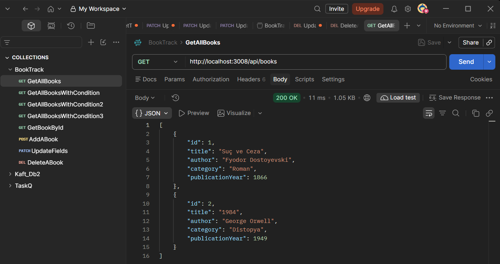
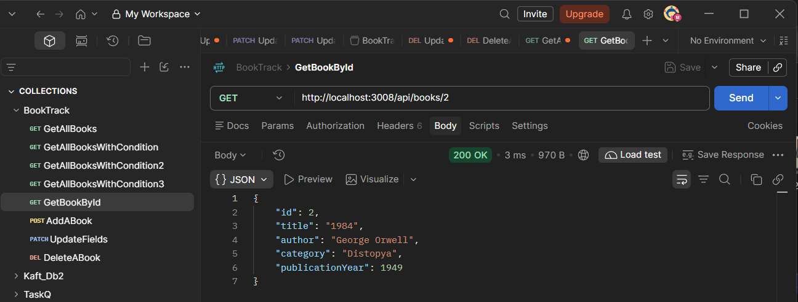
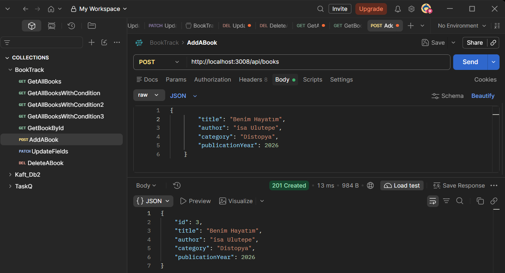
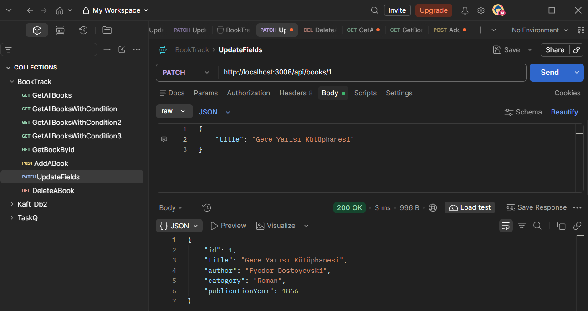
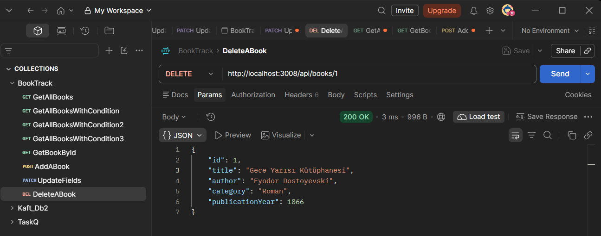
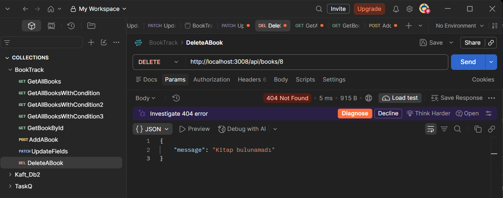
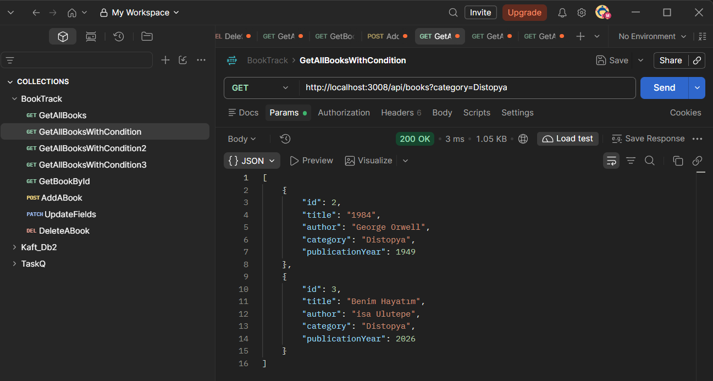
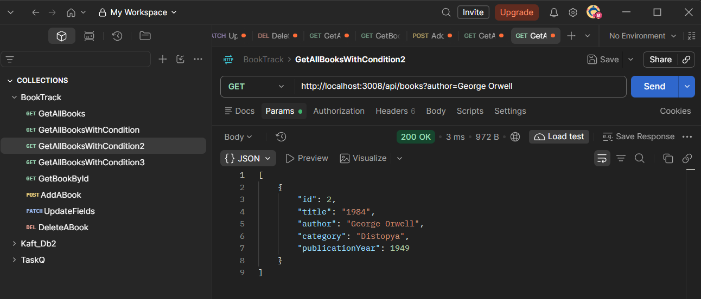
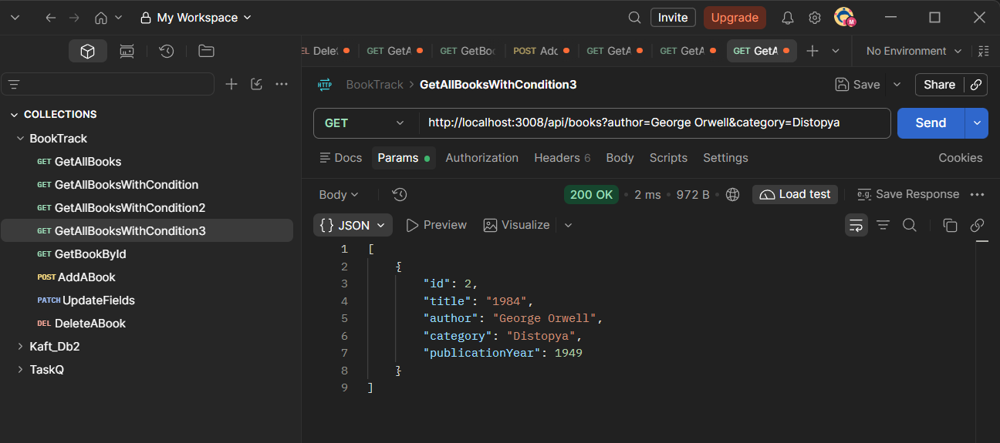

# 📚 BookTrack API

BookTrack, kitap kayıtlarını yönetmek için Node.js ve Express.js kullanılarak geliştirilmiş bir REST API projesidir. Uygulama; kitap ekleme, listeleme, detay görüntüleme, güncelleme ve silme işlemlerini destekler. 

## 📄 Proje Raporu

Projenin detaylı analizine ve mimarisine aşağıdaki bağlantıdan ulaşabilirsiniz:

[📥 Node.js ile REST API Projesi – PDF Raporu](Nodejs-ile-REST-API-Projesi.pdf)

## 🚀 Özellikler

* Kitapları listeleme ve detaylarını görüntüleme
* Yeni kitap kaydı oluşturma
* Mevcut kitap bilgilerini güncelleme
* Kitap kayıtlarını silme
* Yazara ve kategoriye göre filtreleme
* Gelen veriler için doğrulama kuralları
* Merkezi hata yönetimi
* HTTP isteklerini kaydetmek için Logger Middleware

## 🛠️ Kullanılan Teknolojiler

* **Node.js** — JavaScript çalışma ortamı
* **Express.js** — HTTP sunucusu ve REST API geliştirme çatısı
* **JavaScript (ES Modules)** — Uygulama kodları
* **Postman** — API endpoint'lerini test etmek için

## 📋 Gereksinimler

Projeyi çalıştırmak için bilgisayarında aşağıdakiler bulunmalıdır:

* Node.js
* npm (Node.js ile birlikte gelir)
* Git (projeyi klonlamak için)
* Postman (API testleri için, isteğe bağlı)

## ⚙️ Kurulum

### 1. Projeyi klonla

```bash
git clone <REPOSITORY_URL>
```

Proje klasörüne gir:

```bash
cd BookTrack
```

> `<REPOSITORY_URL>` alanını GitHub üzerindeki kendi depo adresinle değiştir.

### 2. Bağımlılıkları yükle

```bash
npm install
```

Bu komut, `package.json` dosyasında belirtilen bağımlılıkları yükler.

### 3. Sunucuyu başlat

```bash
npm start
```

Sunucu varsayılan olarak aşağıdaki adreste çalışır:

```text
http://localhost:3008
```

## 🧱 Proje Yapısı

```text
BookTrack/
├── src/
│   ├── controllers/
│   │   └── bookController.js
│   ├── data/
│   │   └── books.js
│   ├── routes/
│   │   └── bookRoutes.js
│   ├── services/
│   │   └── bookService.js
│   ├── rules/
│   │   └── allowed.js
│   ├── middleware/
│   │   ├── logger.js
│   │   └── errorHandler.js
│   ├── app.js
│   └── server.js
├── package.json
└── README.md
```

*Not: Dosya adları ve klasörler mevcut proje yapınla eşleşmelidir.*

## 📡 API Endpoint'leri

| HTTP Metodu | Endpoint                            | Açıklama                                     |
| ----------- | ----------------------------------- | -------------------------------------------- |
| GET         | `/api/books`                        | Tüm kitapları listeler.                      |
| GET         | `/api/books?author=George%20Orwell` | Yazara göre filtreleme yapar.                |
| GET         | `/api/books?category=Roman`         | Kategoriye göre filtreleme yapar.            |
| GET         | `/api/books/:bookId`                | Belirli bir kitabın detaylarını getirir.     |
| POST        | `/api/books`                        | Yeni kitap oluşturur.                        |
| PATCH       | `/api/books/:bookId`                | Mevcut kitabın belirli alanlarını günceller. |
| DELETE      | `/api/books/:bookId`                | Belirtilen kitabı siler.                     |


## 💾 Veri Yönetimi

Kitap kayıtları uygulama belleğinde bir JavaScript dizisi içerisinde tutulmaktadır. Bu nedenle veriler kalıcı değildir; sunucu yeniden başlatıldığında eklenen, güncellenen veya silinen kayıtlar başlangıç verilerine döner.

## 📌 Projenin Amacı

Bu proje; Node.js ve Express.js kullanarak REST API geliştirme, HTTP metotlarını kullanma, CRUD (Create, Read, Update, Delete) işlemlerini uygulama, kodu katmanlara ayırma, veri doğrulama ve middleware tabanlı hata yönetimi konularında pratik kazanmak amacıyla geliştirilmiştir.

> **Not:** Proje başlangıcında kullandığım kurulum komutları aşağıdadır:

```bash
npm init -y
npm install express
npm pkg set type="module"
npm pkg set scripts.start="node src/server.js"
```

## 🧪 API Testleri ve Ekran Görüntüleri

BookTrack API endpoint'leri Postman kullanılarak test edilmiştir. Testler kapsamında kitap listeleme, detay görüntüleme, oluşturma, güncelleme ve silme işlemleri ile hata yönetimi kontrol edilmiştir.

### Kitapları Listeleme

Sistemde kayıtlı kitapları getirir.



### Kitap Detayını Görüntüleme

Belirtilen ID'ye ait kitabın bilgilerini getirir.



### Yeni Kitap Oluşturma

Gönderilen JSON verileriyle yeni bir kitap kaydı oluşturur.



### Kitap Bilgilerini Güncelleme

Belirtilen kitabın yalnızca gönderilen alanlarını günceller.



### Kitap Silme

Belirtilen kitabı kayıt listesinden kaldırır.



### Hata Yönetimi

Geçersiz veya bulunamayan kaynaklara yönelik isteklerde uygun hata yanıtlarının döndürülmesini gösterir.



### Ekstra Filtreleme Özellikleri
Kategoriye göre, yazara göre ya da her ikisine göre filtreleme yapılabilir.







